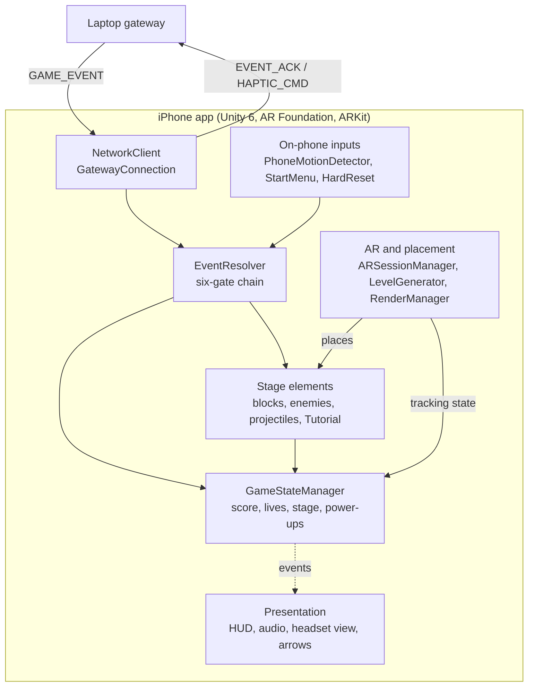
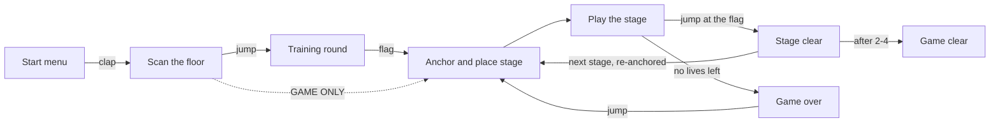

# Architecture

The visualizer is an iOS app, worn in a head-mounted viewer, that turns the player's room into a first-person Mario-style level. It receives classified body actions from the laptop gateway, decides what each one does in the game, and renders the result over the live camera feed. **It is the only part of the system that holds game state.**

This page is the map. Details live in [`GAME_DESIGN.md`](GAME_DESIGN.md) (rules and numbers), [`GATEWAY_PROTOCOL.md`](GATEWAY_PROTOCOL.md) (wire format) and [`VISUALIZER_STATUS.md`](VISUALIZER_STATUS.md) (full development log).

## The system around it

```
Wrist and thigh boards (IMU, 50 Hz) --BLE--> Laptop gateway --TCP over SSH--> Ultra96 (1D-CNN on the FPGA)
                                                  |  ^
                               GAME_EVENT (JSON)  v  |  EVENT_ACK, HAPTIC_CMD
                                             iPhone visualizer (this project)
```

- The phone holds **one** connection: a secure WebSocket to the gateway. It never talks to the Ultra96.
- The gateway owns the session and event numbering and forwards every classification.
- The phone owns all game state, because whether a stomp lands depends on where the enemy is in the room, which only the phone knows.
- Haptics start on the phone: it sends `HAPTIC_CMD`, and the gateway forwards it to the wearable over BLE.

## Modules



| Layer | Scripts (`Assets/Scripts/`) | Responsibility |
|---|---|---|
| Network | `GatewayConnection`, `NetworkClient`, `GatewayMessages` | TLS socket with certificate pinning and the WebSocket handshake on a background thread; message parsing, ACKs, haptics and reconnection on the main thread. Only `GatewayMessages` knows the wire format. |
| Game core | `EventResolver`, `GameStateManager` | The gate chain that turns an action into an outcome; the single owner of score, lives, coins, stage, power-ups and timed states (airborne, ducked, invulnerable). |
| Inputs on the phone | `PhoneMotionDetector`, `StartMenu`, `HardReset` | Jumps and squats from head height; the start menu by nod and clap; a reset by looking straight up for 5 s. |
| AR and placement | `ARSessionManager`, `LevelGenerator`, `RenderManager`, `Gameplay/PlayerBody` | The floor scan and tracking state; anchoring and fitting each stage to the room; LiDAR depth occlusion; the 1.70 m stage height. |
| Game elements | `Gameplay/*` (`QuestionBlock`, `Goomba`, `Koopa`, `Bowser`, `BulletBillCannon`, ...), `Tutorial` | Each piece's behaviour and its response to a hit; the training round. Targets derive from `InteractableBase`. |
| Presentation | `HUDController`, `AudioManager`, `HeadsetView`, `ScreenTransition`, `EnemyIndicator`, `ObjectiveIndicator`, `RangeRing`, `ProximityFade` | What the player sees and hears. These read state and listen to events; they never change the game. |

Two rules keep this maintainable:

1. **`EventResolver` depends only on `GameStateManager`.** Everything else learns of outcomes through C# events (`OnEventProcessed`, `OnImpact`, `OnLifeLost`, `OnStageStarted`, ...).
2. **Logic lives in `Tick(...)` methods** that take time and pose as arguments, so the headless tests drive them without a phone or camera.

## The gate chain

Every action, from the gateway or the phone's own sensing, goes through `EventResolver.Resolve` in this order. Only gate 6 changes the game.

| Gate | Checks | Rejected example |
|---|---|---|
| 1. Session | A stage is live (not scanning, tracking not lost, not between stages, not at game over) | An action during the scan |
| 2. Validity | Confidence ≥ 0.6, known label, not a duplicate `event_id`, not a repeat of the same motion | The third report of one stomp |
| 3. Capability | The player can do it now | A throw with no shell and no fire flower |
| 4. Spatial | A target is in reach and in front of the player | A punch with no brick within 0.8 m |
| 5. Target state | The target can still be used | A jump under a spent ? block |
| 6. Resolution | Apply the outcome, effects, sound, HUD message, haptic | — |

Gates 1–2 mean "not registered"; gates 3–5 mean "recognised but not permitted", and get an orange HUD reason, a "bonk" and a `denied` haptic.

Three mechanisms make an imperfect classifier playable (details in `GAME_DESIGN.md`):

- **One event per motion.** The gateway forwards every classification; the phone keeps the first of a run of the same label (0.5 s continuation, 1.2 s maximum run).
- **Jumps and squats from the phone.** In the headset, a head rise of 10 cm at 0.5 m/s is a jump and a drop of 28 cm is a squat. The other source's report of the same move within 1.5 s is a repeat.
- **Arm moves resolve to what fits.** If exactly one of clap, throw and punch would do something now, that one resolves, whichever was read.

## A frame

1. **Camera image** — `ARCameraBackground`.
2. **3D content** — the camera's pose comes from ARKit every frame; stages are children of a floor anchor, so they stay fixed in the room.
3. **Depth occlusion** — LiDAR phones only (`RenderManager`); switched off automatically elsewhere.
4. **HUD** — a screen-space canvas.
5. **Headset split** — `HeadsetView` renders 1–4 to a texture and shows it once per lens through `Shaders/HeadsetLens.shader` (barrel pre-distortion). Both eyes see the same image: there is one rear camera.

## A session



`LevelGenerator` anchors each stage at the player's floor position (yaw only), searches the scanned floor out to 6 m for a spot facing away from the player with detected floor under all four corners and the flag (and, with LiDAR, clear of the room mesh), and takes the best-centred one. The designed stage is tried at 100, 85, 70 and 55 % of its size, then three fallback templates. A cleared stage and its anchor are destroyed and the next is anchored where the player stands, which bounds memory and tracking drift. Looking straight up for 5 s returns to the start menu from anywhere.

## Content is generated from code

Nothing under `Assets/Prefabs`, `Assets/Stages`, `Assets/Materials` or `Assets/Textures` is hand-edited. Editor scripts build it all:

| Script (`Assets/Editor/`) | Builds |
|---|---|
| `GameContentSetup` | Every prefab, material and stage, and the scene wiring |
| `StageDesigns` | The campaign as data: one `Design` per stage (pieces at floor positions) |
| `PixelArt` | The pixel-art textures, from character grids |
| `HUDSetup` | The HUD and the headset view |
| `ScanSetup`, `NetworkSetup`, `LidarSetup`, `SimulationSetup` | One-off scene and project configuration |

Run them from **Tools ▸ MARIO** in the Editor or headless (see the README). They are idempotent: change the script, re-run, commit the regenerated assets. Sound effects are synthesised at startup by `AudioManager`.

## Extending it

- **A new stage:** add a `Design` to `StageDesigns.Campaign`, then run `GameContentSetup.Run`; it builds the prefab under `Assets/Stages/Campaign` and adds it to `LevelGenerator`'s campaign.
- **A new stage element:** derive from `InteractableBase` (`RespondsTo`, `IsActionable`, `ResolveHit`; override `HitPoint` or `IsHitAt` for a larger hitbox), build its prefab in `GameContentSetup`, and place it from `StageDesigns`.
- **A new action label:** add it to `EventResolver.Actions` and give it a rule in `EventResolver` (gates 3–6) and a key in `EditorActionInput`; set its haptic limb in `NetworkClient` if it is not "both". The protocol needs no change: `GAME_EVENT` carries only the label.
- **A different gateway:** pass `-gatewayUrl` and `-pin` to a `BuildScript` build, or add a profile in `BuildScript.cs`.
- **Always** run `GameplaySmokeTest` afterwards, and add checks for the new behaviour there.
