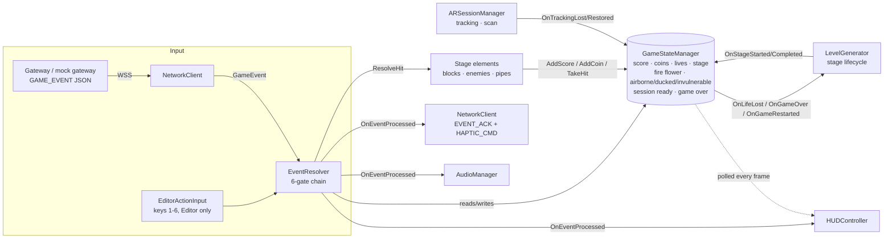
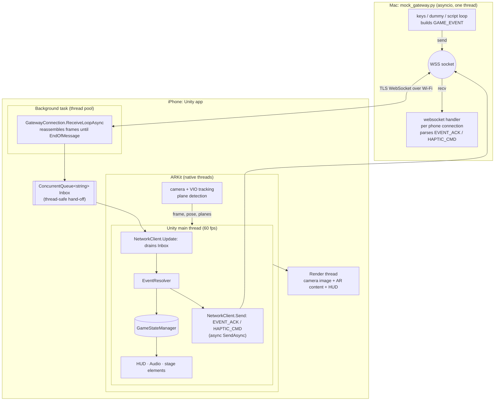
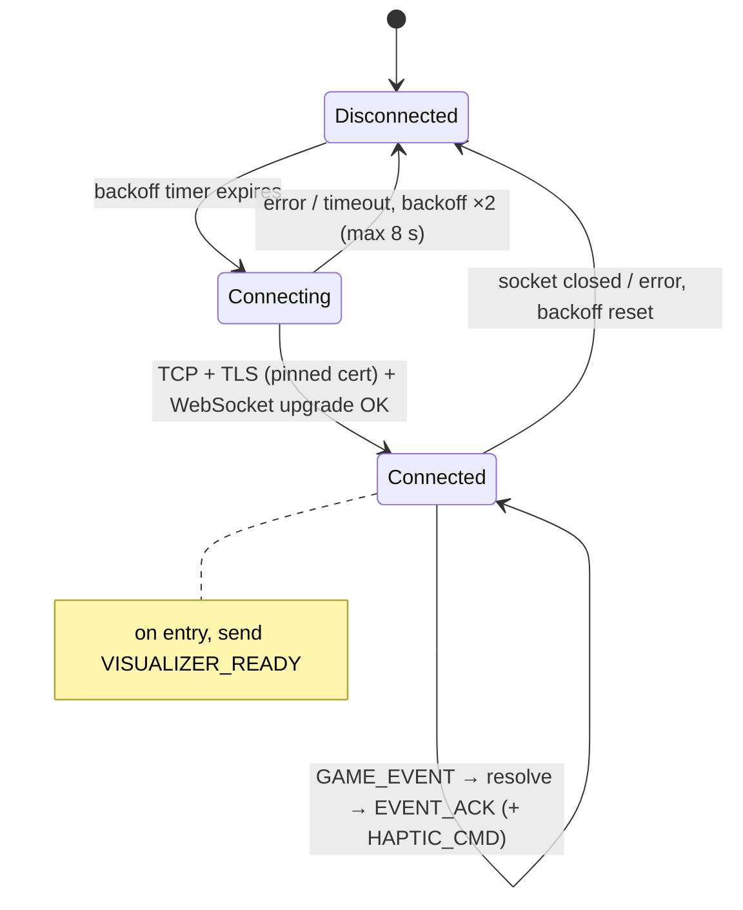
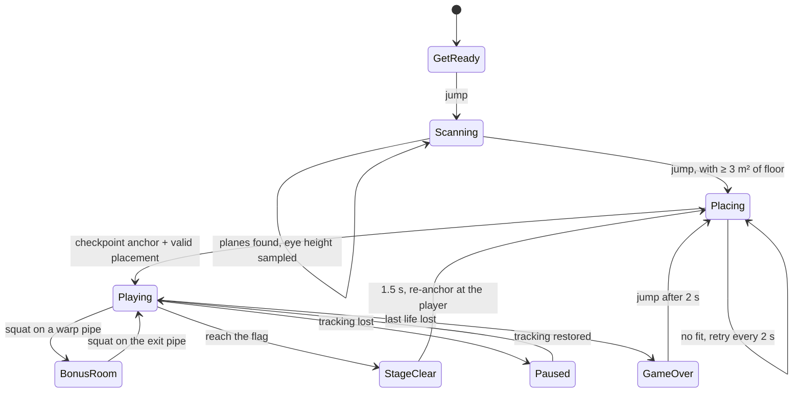
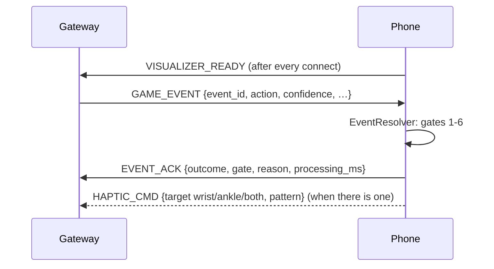

# AR Visualizer: Demo Guide (individual subcomponent test)

This covers the live session (Prof Peh: the app and its AR features; the TA: the code and the project structure) and the recorded video, which must be **10 minutes or less**. Each section maps to a rubric item.

| Rubric item (Live + Video) | Where it's shown | Sections |
|---|---|---|
| **Visualizer GUI design**: data correctly visualized, with dummy inputs | HUD reacting to random dummy `GAME_EVENT`s from the mock gateway | §3, §6 |
| **CV and AR effects**: tracking the physical environment; placing virtual assets in it | Scan, floor-only detection, anchors, placement search, occlusion | §4 |
| **Application state engine**: where state is stored and how it's passed to the visualizer | `GameStateManager`, the gate chain, events → HUD, audio and elements | §5 |
| **Demonstration on the actual platform** | iPhone 17, handheld or in the VRG Pro headset | §2, §7 |

---

## 1. Before the lab (checklist)

- [ ] **Latest build on the iPhone:** Unity closed, then *Tools ▸ MARIO ▸ Build iOS* → `xcodebuild` → `devicectl install`; see `VISUALIZER_STATUS.md`, "Device testing".
- [ ] **Phone and Mac on the same Wi-Fi.** On the phone, Local Network access must be allowed (Settings ▸ Privacy ▸ Local Network ▸ MARIO).
- [ ] **Mock gateway runs:** `python3 tools/mock_gateway.py --keys`, then check the phone's HUD shows **● ONLINE**.
- [ ] **Dummy file ready:** `tools/dummy_packets.json`, open in an editor for the "change the dummy packets" request.
- [ ] **Editor ready for the code walk-through:** Unity open on `SampleScene` (the XR Simulation Museum room), and VS Code open on `Assets/Scripts`.
- [ ] **Charged:** phone at 100 %, headset lenses clean, focus knob set.
- [ ] **Fallbacks rehearsed:** see §8.

## 2. Live demo runbook (about 8 minutes)

1. **Launch on the phone** (handheld first; the headset is optional, see §8). The HUD shows **GET READY – JUMP TO START SCANNING**. On the Mac: `python3 tools/mock_gateway.py --keys`, and the terminal shows `[phone1 …] connected`.
2. **Start the scan with a jump (key 1).** Walk round looking at the floor.
   - **What to point out:** only *floor* is highlighted (gold grid). Tables and beds are rejected (ARKit semantic classification). The m² counter and meter grow.
3. **Finish the scan with another jump.** "READY!" appears, then the eye height (calibrated during the scan). The "WORLD 1-1 / FIRST STEPS" intro card pops in and the stage is **anchored to the floor**.
   - **What to point out:** walk round it and it stays put (world tracking and anchors). ? blocks are overhead, bricks at chest height, coins at waist height, all scaled to *your* height.
4. **Play with keys 1–6, each one a real `GAME_EVENT` over TLS/WebSocket:**
   - 1 → jump under a ? block → power-up
   - 2 → stomp a Goomba; stomp a Koopa into its shell
   - 6 → clap to pick up the shell (HELD on the HUD), then 4 → throw it at enemies
   - 4 → throw a fireball (with the flower); 5 → punch a brick
   - 3 → squat to dodge a Bullet Bill
   - Walk to the flag → STAGE CLEAR, and the next stage is re-anchored.
5. **Dummy data, randomised:** quit the keys gateway (`q`) and run `python3 tools/mock_gateway.py --dummy --every 2`. Random packets arrive and the HUD shows each outcome: accepted (green), refused with a reason (orange), low confidence (grey), duplicates silent. The terminal shows the matching ACK colour and the gate that decided it.
6. **"Change the dummy packets":** edit `tools/dummy_packets.json` (for example add `{ "action": "squat", "confidence": 0.3 }` or change an action). The gateway **re-reads it on the next pick**, with no restart, and logs `loaded N dummy packets`. Restarting the gateway also works.
7. **Show robustness:**
   - `k` kicks the connection → OFFLINE → it reconnects with backoff.
   - Cover the camera → TRACKING LOST, and the game pauses (Gate 1).
   - Lose all lives → the GAME OVER screen → jump to restart.

## 3. GUI design with dummy inputs: what to show and say

- **The dummy data is real protocol data.** Every packet is a `GAME_EVENT` exactly as in `Docs/GATEWAY_PROTOCOL.md`: `type`, `protocol_version`, `session_id`, `event_id`, `window_id`, `action`, `confidence`, `timestamp`.
  - The pool is `tools/dummy_packets.json`, including a low-confidence jump (0.42) and a fixed `event_id` that forces a duplicate.
  - `--dummy` picks one **at random** every `--every` seconds; `r` in `--keys` mode sends one on demand.
- **The terminal is uncluttered.**
  - One line per message, aligned columns, colour by kind: → sent cyan, ← ACK green (resolved) or yellow (rejected), ← HAPTIC magenta, status dim.
  - Each phone connection gets its own coloured `[phoneN ip]` tag.
  - The same lines, in plain human-readable text, go to `Logs/mock_gateway.log`.
- **The HUD** (`HUDController`) shows:

  | Area | Contents |
  |---|---|
  | Top bar | score (6 digits), coins, stage (1-2), lives (heart ×N), power (flower icon), connection status |
  | Banner | current state: scanning, tracking lost, placing, flag distance, bonus room |
  | Centre title | STAGE 1-2 / STAGE CLEAR! / WARP! / READY! |
  | Feedback | action results: green for hits and +score, orange for refused with a reason, grey for "move not recognised"; red flash on damage |
  | Game-over screen | final score and the restart prompt |

  The HUD **only reads** game state. It never changes it (see §5).

## 4. CV and AR effects: code walk-through

**Tracking the physical environment (computer vision):**

| What | Where | Key points |
|---|---|---|
| World tracking and camera | `AR Session`, `XR Origin` (AR Foundation → ARKit VIO) | 6-DoF camera pose each frame |
| Floor detection | `ARSessionManager` (`IsFloorPlane`, `RecalculateTotalArea`) | Horizontal planes; ARKit's *semantic classification* keeps `Floor` and rejects Table/Seat. Unclassified planes count only at floor height (±0.15 m). Floor level = the largest Floor plane. |
| Player-controlled scan | `ARSessionManager.StartScan / ConfirmScan` (jumps) | Plane detection is off until the first jump; confirming needs at least 3 m² |
| Player height | `ARSessionManager.SampleEyeHeight` → `PlayerBody` | Median camera height above the floor while scanning |
| Tracking loss and relocalisation | `ARSessionManager.PollTrackingState` | `OnTrackingLost` closes Gate 1 (the game pauses); `OnTrackingRestored` reopens it |
| Room mesh and occlusion (LiDAR iPhones) | `ARMeshManager` (AR Meshes), `RenderManager` + `AROcclusionManager` | Real furniture hides virtual objects; the mesh rejects obstructed placements. The base iPhone 17 has no LiDAR, so this falls back gracefully. |
| Scan visuals | `ScanPlaneVisual` on `AR Scan Plane` | Floor-only gold grid, fading out after the scan |

**Placing virtual assets in the physical environment (graphics/AR):**

| What | Where | Key points |
|---|---|---|
| World-locked checkpoint | `LevelGenerator.CreateCheckpointAnchorAsync` | An `ARAnchor` on the floor at the player's position, yaw only; re-anchored every stage, which bounds drift |
| Placement search | `LevelGenerator.TryFindValidPlacement` | Rings to 6 m and 15° steps, forward arc first. Each candidate must: have detected floor under all 4 corners and the flag; keep clear of the player; need a real walk to the goal; and (LiDAR) not overlap the room mesh. |
| Fitting the room | `LevelGenerator.campaignScales`, `CompressLayout` | The designed stage at 100 / 85 / 70 / 55 %, then the fallback templates |
| Stage content | `StageDesigns` (data) → `GameContentSetup` → prefabs | Campaign 1-1 to 1-4; positions in metres on the floor |
| Body-relative heights | `EyeHeightPlacement` | ? block eyes + 0.35 m; brick 78 %; coin 60 % of eye height |
| Visual effects | `Burst`, `EnemyWaddle`, `Spinner`, `StageGoal` | Particles, knock-outs, flag slide, confetti |
| Headset view | `HeadsetView` + `HeadsetLens.shader` | Side-by-side eyes, lens pre-distortion, HUD safe frame |

## 5. Application state engine: where state lives and how it reaches the visualizer

- **One source of truth.** `GameStateManager` holds all game state. Everything else reads it; it's changed only through its methods (`AddScore`, `AddCoin`, `TakeHit`, `BeginStage`, `CompleteStage`, `RestartGame`, `Jump`, `Duck`, …).
- **Every action goes through `EventResolver.Resolve`**, which has six ordered gates:
  1. **Session:** tracking OK, a stage live, not game over.
  2. **Validity:** confidence ≥ 0.6, and not a duplicate `event_id`.
  3. **Capability:** e.g. at most 2 fireballs in flight.
  4. **Spatial:** a target in range and facing.
  5. **Target state:** e.g. not already spent.
  6. **Resolution.**

  Gates 1–2 mean "not registered"; gates 3–5 mean "not permitted". Each result is returned to `NetworkClient`, which ACKs every event with its gate.
- **The visualizer is updated in two ways.** Transient events arrive through C# events (`OnEventProcessed`, `OnImpact`, `OnLifeLost`, `BulletBillCannon.OnWarning`). Persistent values (score, lives, stage, flower) are polled each frame from `GameStateManager`. The HUD never writes state.
- **Scene wiring.** Stage lifecycle ⇄ state is wired as persistent UnityEvents by `GameContentSetup`.

## 6. Concurrency: block diagram

- **Receiving** runs off the main thread. Complete messages go into a `ConcurrentQueue`, the only shared structure. The main thread drains it in `Update`, so all game state is touched on one thread: no locks in game code.
- **Reconnecting** (`NetworkClient`) uses exponential backoff from 0.5 s to 8 s with ±20 % jitter, and sends `VISUALIZER_READY` after each connect.
- **Fragmentation.** TCP is a stream, so the WebSocket layer frames messages, and `ReceiveLoopAsync` keeps reading until `EndOfMessage` before handing a message over. A message split across TCP segments is reassembled first.

## 7. Protocol FSMs (for the video)

**Connection (phone side, `GatewayConnection` + `NetworkClient`):**

**Game session (`ARSessionManager` + `LevelGenerator` + `GameStateManager`):**

**Message sequence:**

## 8. Video script (10 minutes or less)

| Time | Show | Say / point at |
|---|---|---|
| 0:00–0:40 | Title, then the system diagram (§6) | Role in the system: the phone receives classified actions over WSS and renders the AR game |
| 0:40–2:30 | **Phone:** get ready → jump → scan → jump → stage appears | Floor-only detection, the m² meter, eye-height calibration, anchoring; walk round the stage (§4) |
| 2:30–4:30 | **Phone plus terminal side by side:** `--dummy --every 2`, then edit `dummy_packets.json` | Real packet format, random choice, colour-coded ACKs by gate, HUD feedback colours (§3) |
| 4:30–6:00 | **Phone:** play 1-2 with keys: power-up, punch or fireball, stomp, Koopa, warp to the bonus room and back, Bullet Bill and squat | AR effects, particles, audio |
| 6:00–7:30 | **Code:** `EventResolver.RunGates`, `GameStateManager`, state diagram (§5) | Where state lives, the 6 gates, events vs polling |
| 7:30–8:45 | **Code:** `ARSessionManager.IsFloorPlane`, `LevelGenerator.TryFindValidPlacement`, `EyeHeightPlacement` | Tracking and placement (§4) |
| 8:45–9:40 | **Code:** `GatewayConnection.ReceiveLoopAsync` + the concurrency diagram, then the FSMs (§6, §7) | Threads, the queue, fragmentation, reconnect |
| 9:40–10:00 | Headset clip (optional) | Side-by-side lens view; limits of mono passthrough |

**Recording tips:**
- Screen-record the phone (Control Centre ▸ Screen Recording) *and* film it in hand, so the room is visible.
- For code, zoom the editor to at least 18 pt so it survives YouTube compression.
- Put the diagrams in full screen (GitHub renders the Mermaid blocks in this file).

## 9. Likely questions and answers

- **Why WebSocket over TLS?** The phone can't host a server, and WebSocket gives message framing over TCP. TLS with **certificate pinning** (SHA-256 of the gateway's cert) prevents impersonation.
- **Why a queue?** Unity objects may only be touched on the main thread. The receive task never touches game state; it enqueues complete messages.
- **Why ACK every event, even duplicates?** So the gateway sees an outcome for every `event_id`, whichever gate decided it.
- **How is a duplicate detected?** Gate 2 keeps a bounded set of recent `session_id/event_id` keys (1024, FIFO).
- **What if the classifier sends the same action every window?** Protocol v2 makes every action discrete: the gateway sends one event per physical motion. The phone also drops repeated `event_id`s (gate 2).
- **How do you avoid placing a stage on a table?** Semantic classification (Floor only), a floor-height tolerance, floor required under all 4 corners and the flag, and on LiDAR devices, room-mesh overlap tests.
- **What if tracking is lost?** Gate 1 closes, enemies freeze, and the banner says "look around slowly". The stage stays anchored and resumes when ARKit relocalises.
- **How is the project structured?** See `VISUALIZER_STATUS.md` §3: `Scripts/` (runtime), `Scripts/Gameplay/` (elements), `Editor/` (one-click setup, content builders, headless tests).

## 10. Fallback plans

| Problem | Fallback |
|---|---|
| Headset is uncomfortable or disorienting | Demo handheld. Two-finger tap before wearing toggles headset mode; it's on by default on the phone. |
| Wi-Fi blocked or unstable | Personal Hotspot from the phone, with the Mac joined. Or, in the Editor, keys 1–6 drive `EventResolver` directly in the Museum simulation. |
| Placement is slow in a cramped room | Stand in open floor; scan more floor before the finishing jump. Stages compress to 55 %, and the fallback templates fit about 1.2 × 2 m. |
| Phone build fails on the day | Keep yesterday's build installed; run the Editor Museum simulation as a backup demo. |
| Someone asks for a code change live | Dummy packets: edit `tools/dummy_packets.json` (hot-reloaded). Game values: edit in the Inspector, or in `StageDesigns.cs` then Tools ▸ MARIO ▸ Build Game Content, and re-run Play. |
